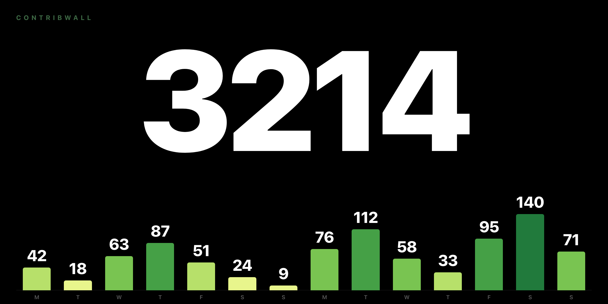

<p align="center">
  
</p>

<h3 align="center">Your GitHub contributions, full screen.</h3>

<p align="center">
  A black wall. One big number. Your last two weeks in green.<br>
  Point a spare monitor at it and forget it's there.
</p>

<p align="center">
  
  
</p>

<br>

## Install

```sh
curl -fsSL https://raw.githubusercontent.com/ilazaridis/contribwall/main/install.sh | sh
```

Rather not use a terminal? [Download the zip](https://github.com/ilazaridis/contribwall/archive/refs/heads/main.zip),
unzip it, and double-click **Install.command**.

Your screen lights up. It comes back on its own after a reboot.

<br>

## Use

```sh
contribwall                 # put it on screen
contribwall range month     # week · 14 · month · any 1–90
contribwall display Dell    # pick a screen by name
contribwall awake on        # stop the screens sleeping
contribwall off             # take it off
```

`contribwall status` tells you what's running and what it's showing.

<br>

## Needs

**macOS** · **[GitHub CLI](https://cli.github.com)**, signed in · **Chrome**, Brave, Edge or Chromium

It reads *your* contributions through your own `gh` login, so private ones count
and there's no token to paste anywhere.

<br>

## Settings

`~/.config/contribwall/config.json` — changes land within a minute, nothing to restart.

| | |
|---|---|
| `days` | how far back the bars go, `1`–`90` |
| `display` | screen name fragment, or `""` for the second one |
| `ramp` | `darker` or `brighter` — which end of the green is a busy day |
| `refreshSeconds` | how often it checks |
| `port` | local port, default `8723` |

<br>

## How it works

A small Python server asks the GitHub CLI for your contribution calendar and
serves one local page. A browser window sits on your screen in fullscreen and
re-polls it every minute. Two `launchd` agents keep the server up and put the
window back after a reboot. Nothing leaves your machine except the GitHub query.

<br>

## Uninstall

```sh
~/.local/share/contribwall/uninstall.sh
```

Or double-click **Uninstall.command**. Your settings survive; delete
`~/.config/contribwall` to finish the job.

<br>

<p align="center"><sub>MIT · built for a spare monitor that deserved better</sub></p>
